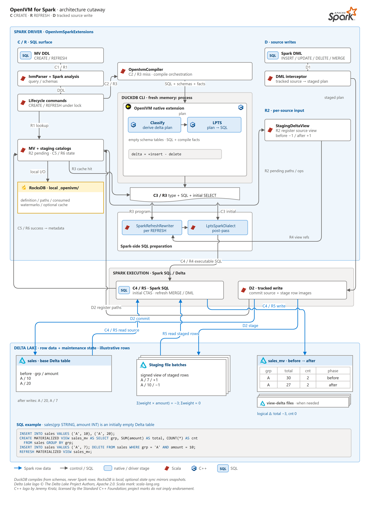

<p align="center">
  
</p>

<h1 align="center">OpenIVM for Apache Spark</h1>

<p align="center">
  Incremental materialized view maintenance for Spark SQL and Delta Lake.
</p>

<p align="center">
  <a href="https://openivm.org/">openivm.org</a> ·
  <a href="#getting-started">Getting started</a> ·
  <a href="#architecture">Architecture</a> ·
  <a href="#documentation">Documentation</a> ·
  <a href="https://github.com/openivm/ivm-bench">IVM Bench</a>
</p>

OpenIVM for Spark is a Spark SQL extension that compiles and applies
incremental maintenance plans for materialized views. Spark executes the
resulting SQL against Delta Lake; OpenIVM and LPTS compile the plans in a
separate DuckDB process. The default interception mode captures changes without
requiring Delta Change Data Feed (CDF); CDF is also available as an alternative.

> **Status:** Under active development.

## Contents

- [Getting started](#getting-started)
- [Architecture](#architecture)
- [Documentation](#documentation)
- [Development](#development)
- [Ecosystem and benchmarks](#ecosystem-and-benchmarks)
- [License and marks](#license-and-marks)

## Getting started

| Target | Spark | Delta Lake | Scala | Java |
| --- | --- | --- | --- | --- |
| `spark-3.5` | 3.5.1 | 3.2.0 | 2.12.17 | 17 |
| `spark-4.1` | 4.1.0 | 4.2.0 | 2.13.17 | 21 |

Build the extension in the pinned devcontainer, then
[activate it in Spark](spark-ext/docs/ACTIVATION.md). Set
`spark.sql.extensions=org.openivm.spark.OpenIvmSparkExtensions` and
`spark.openivm.enabled=true`; the feature gate is off by default. See the
[extension guide](spark-ext/README.md) for runtime and artifact details.

With the extension enabled and a Delta table named `sales` with columns
`region STRING` and `amount INT`, create and refresh a materialized view using
Spark SQL:

```sql
CREATE MATERIALIZED VIEW sales_summary AS
  SELECT region, SUM(amount) AS total, COUNT(*) AS cnt
  FROM sales
  GROUP BY region;

INSERT INTO sales VALUES ('West', 50);
REFRESH MATERIALIZED VIEW sales_summary;
SELECT * FROM sales_summary;
```

The view definition must be valid in both Spark SQL and DuckDB. See
[materialized views](spark-ext/docs/MATERIALIZED_VIEWS.md) for supported
refresh strategies, syntax, and limitations.

## Architecture

<p align="center">
  
</p>

The diagram traces the default **interception** path. Spark captures tracked
source changes as Delta staging data, while local RocksDB catalogs hold
definitions, dependencies, progress and optional cached compilation results.
The DuckDB subprocess compiles from SQL and schemas—not Spark's base rows.
Spark rewrites and executes the maintenance SQL and advances progress after
successful application.

[Open the editable DrawIO](docs/images/openivm-spark-architecture.drawio) ·
[Read the architecture overview](docs/architecture/openivm-spark/0.OVERVIEW.md) ·
[Follow an aggregate refresh end to end](docs/architecture/openivm-spark/13-end-to-end-trace-aggregatesumspec.md)

## Documentation

| Start here | Guides |
| --- | --- |
| Use the extension | [Activation](spark-ext/docs/ACTIVATION.md) · [Materialized views](spark-ext/docs/MATERIALIZED_VIEWS.md) · [Streaming tables](spark-ext/docs/STREAMING_TABLES.md) |
| Understand the internals | [Documentation index](docs/README.md) · [Spark extension](docs/architecture/openivm-spark/0.OVERVIEW.md) · [OpenIVM](docs/architecture/openivm/0.OVERVIEW.md) · [LPTS](docs/architecture/lpts/0.OVERVIEW.md) |
| Follow the data | [DML and staging](docs/architecture/openivm-spark/3-dml-interception-and-staging.md) · [RocksDB and Delta storage](docs/architecture/openivm-spark/7-state-storage-rocksdb-and-delta.md) · [MV lifecycle](docs/architecture/openivm-spark/8-mv-lifecycle-create-refresh-drop.md) |
| Diagnose and observe | [FULL_REFRESH debugging](docs/architecture/openivm-spark/11-full-refresh-demotion-debugging.md) · [Execution telemetry](spark-ext/docs/EXECUTION_TELEMETRY.md) · [SQL insights](spark-ext/docs/SQL_INSIGHTS.md) |

## Development

Development and CI use the pinned, content-addressed devcontainer and the
repository's locked Nx CLI. From a WSL or Linux host:

```bash
./contrib/bootstrap-dev-env.sh
npx --no-install nx run devcontainer:up
npx --no-install nx run devcontainer:exec -- \
  npx --no-install nx run spark-ext:verify-all
```

When already inside the devcontainer, run the `spark-ext` target directly.
See [Contributing](CONTRIBUTING.md), [development commands](spark-ext/docs/DEVELOPMENT.md),
and [headless devcontainer operations](docs/devcontainer/headless-operations.md).

## Ecosystem and benchmarks

- [OpenIVM](https://github.com/openivm/openivm) — the incremental view maintenance engine.
- [LPTS](https://github.com/cwida/lpts) — logical-plan-to-SQL serialization.
- [IVM Bench](https://github.com/openivm/ivm-bench) — benchmark incremental view maintenance across engines.

## License and marks

The project is available under the [MIT License](LICENSE). The header uses the
[OpenIVM icon](https://github.com/openivm/openivm-site/tree/main/brand).
Apache Spark, Spark, and the Spark logo are trademarks of the Apache Software
Foundation; this project is not affiliated with or endorsed by the ASF.

The architecture uses project marks for identification: [Apache Spark](https://spark.apache.org/trademarks.html),
[DuckDB](https://github.com/duckdb/duckdb-web/tree/main/images/designmanual),
[RocksDB](https://github.com/facebook/rocksdb/blob/main/docs/static/logo.svg),
[Scala](https://www.scala-lang.org/resources/img/scala-logo-large.svg),
and [C++](https://github.com/isocpp/logos) (logo by Jeremy Kratz, licensed by
the Standard C++ Foundation). Delta Lake logo © The Delta Lake Project Authors,
Apache 2.0.
