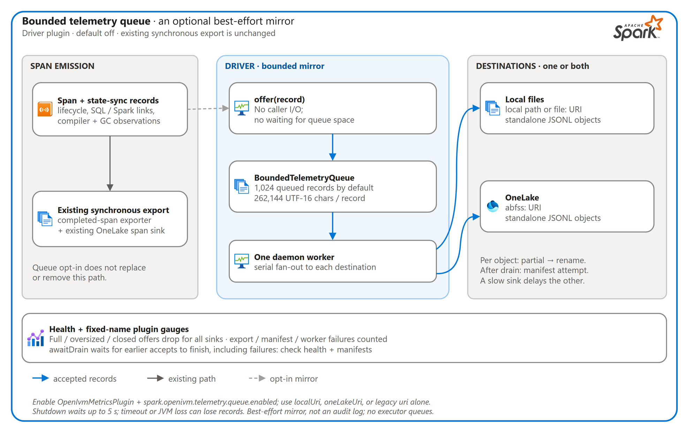

# Bounded telemetry queue

`BoundedTelemetryQueue` is a **disabled-by-default, best-effort diagnostic
mirror**, not an audit log or a durability guarantee. It does not change or
replace the synchronous [completed-span exporter](EXECUTION_TELEMETRY.md) or
the existing OneLake span sink.

[Editable diagram source](../../docs/images/openivm-bounded-telemetry.drawio).

## Configure before Spark starts

Use the [activation guide](ACTIVATION.md) to load the extension, then set these
driver `SparkConf` properties before creating the session; queue configuration
is read once from that configuration and Hadoop `Configuration`.

| Property | Default | Meaning |
| --- | --- | --- |
| `spark.openivm.telemetry.queue.enabled` | `false` | Enables the queue when `true`. |
| `spark.openivm.telemetry.queue.uri` | Unset | Legacy single destination: a local path, `file:` URI or `abfss:` URI. |
| `spark.openivm.telemetry.queue.localUri` | Unset | Explicit local destination: a local path or `file:` URI. |
| `spark.openivm.telemetry.queue.oneLakeUri` | Unset | Explicit OneLake destination: an `abfss:` URI. |
| `spark.openivm.telemetry.queue.capacity` | `1024` | Maximum queued records; must be positive. |
| `spark.openivm.telemetry.queue.maxChars` | `262144` | Maximum UTF-16 characters per record; must be positive. |

When enabled, specify either the legacy URI alone, or one or both explicit
URIs; mixing them is rejected. Setting both explicit URIs mirrors each
accepted record to both destinations. OneLake requires the host's configured
Hadoop ABFS connector and credentials; do not put credentials in example
configs or diagnostic payloads.

Register `org.openivm.spark.plugin.metrics.OpenIvmMetricsPlugin` in
`spark.plugins`, retaining any other plugins your application needs.
Its driver plugin constructs the queue once, regardless of
whether Spark-native metrics are enabled, and stops accepting at plugin
shutdown, waiting up to five seconds for the daemon worker to drain. Invalid
configuration disables the queue and logs a generic warning without exposing
the URI; `BoundedTelemetryRuntime.configurationFailureCount` records the failure.
The executor plugin does not create queues.

## Emission and drain semantics

The shared span and state-sync emission path mirrors records to the queue
without replacing the existing OneLake mirror. It performs no I/O or waiting
for space on the caller thread and writes standalone
JSONL objects. This is not a lock-free API: admission uses a gate lock.
`BoundedTelemetryRuntime.health` exposes the most recent queue's
health, including after shutdown. The lower-level `offer` returns false on
rejection. A shutdown timeout or hard JVM termination can lose records.
`BoundedTelemetryRuntime.awaitDrain(timeoutMs)` waits without shutdown for
records accepted before the call to finish export to all destinations, and
returns false on timeout or when no queue is active. A true result includes
failed exports, so inspect health for failures and drops; later offers are not
part of the barrier.

## Fan-out, health and manifests

Each destination uses a random run prefix and publishes unique objects by
writing a partial object then renaming it. One bounded queue and worker fan out
serially: a slow destination can delay the other, while individual write failures
do not prevent the other write. Queue rejection drops the record for every
configured destination. Global accepted counts records accepted once; global
published counts records published to all destinations, and global export
failures counts records for which any destination failed. Per-destination
accepted, published, dropped, export failures and manifest failures are exposed
in health and fixed-name plugin gauges. Worker failures are counted separately.

After draining, each destination attempts a `*-manifest.json` with UTC times,
aggregate and per-destination counters. Each manifest is a snapshot: its
per-destination `manifest_state` says `not_attempted`, `writing`, `published`,
or `failed` at the time of serialization. Later failures and rejected offers
are reflected in health, not necessarily earlier manifests. Objects may be
absent on filesystem failure, and a failed manifest cannot report its own failure.
Consumers must inspect health and the manifest and must not treat this
best-effort mirror as an audit log. Counters have no labels;
span payloads themselves can contain identifiers and require appropriate
access controls. No errors or destination URIs are emitted as metric labels.

## Read traces without double-counting

### Lifecycle phases

When enabled, lifecycle phase records include UTC start time, monotonic start,
inclusive and exclusive nanoseconds, refresh ID, optional request ID and a
parent phase ID. Exclusive time subtracts only directly nested instrumented
phases on the same thread; it does not subtract uninstrumented or asynchronous
work. This is not a complete exclusive-query-time accounting.
An instrumented phase first emits a `phase_started` record with the same
refresh ID and phase ID before its body runs; its later `phase` record reports
the outcome and measured durations. External intervals observed only after
completion emit just a `phase` record. Queue drops can leave either side absent.

### Spark jobs and generated SQL

Generated SQL and collect boundaries carry an explicit Spark local property.
The driver listener records job-to-stage links, stage attempts and Spark SQL
execution IDs. Stage timestamps come from Spark's wall-clock event times, not
the driver's monotonic clock. Job stage tracking is bounded and marks truncation
in the job-start record. Queue drops can also break links. Checkpoint request
records carry a parent operation ID when a lifecycle trace is active.

See [generated action diagnostics](EXECUTION_TELEMETRY.md#generated-action-diagnostics)
for the limits of source-to-action ownership.

### State synchronization and compiler helpers

When state synchronization is configured, refreshes also report the root
barrier's read-lock wait and hold intervals. They overlap other phases and do
not assert exclusive time. The compiler emits driver and helper phase durations
with the refresh operation ID; the helper uses a separate clock domain and
its events can be lost on forced termination. Malformed or unavailable helper
reports increment `CompileTraceDiagnostics.failureCount` and produce a
rate-limited, sanitized warning.

### Garbage collection

The same queue flag enables `openivm_gc` plan, cleanup and orphan-sweep
records with monotonic inclusive durations, UTC start times, reference and
tombstone counts, deletion counts, and a refresh operation ID when present.
The sweep runs asynchronously and carries its parent ID explicitly; these
intervals overlap lifecycle phases and do not provide exclusive time. The
counts describe the collector's existing behavior, not a safety guarantee
about cross-process deletion.

## Checkpoint safety and sink topology

Checkpoint safety code can inspect the destinations of all live workers,
including timed-out drains, with `BoundedTelemetryRuntime.sinksDisjoint`.
It must use `withSinkTopology` to serialize an epoch check and the guarded
cached-ACK selection with queue registration. The epoch advances before every
registration attempt, even a disabled or unsuccessful one. A disjointness check
on its own is only a snapshot and cannot fence a subsequent registration.

See [state synchronization](STATE_SYNCHRONIZATION.md) for checkpoint publication,
restore, single-writer requirements and the opt-in reuse constraints.
