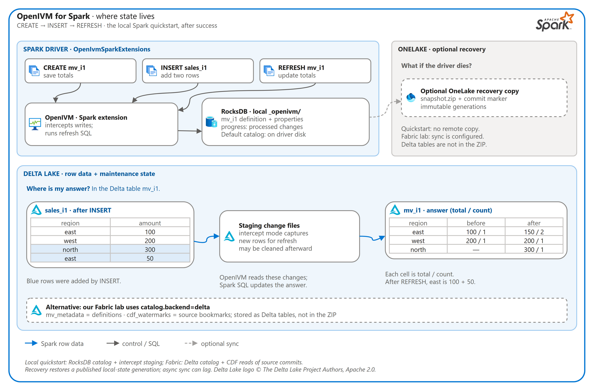

# State synchronization

## Where state lives

The local quickstart uses RocksDB metadata and intercept staging; configured
Delta catalogs and CDF keep progress in Delta. Optional recovery copies do not
contain the Delta tables, and asynchronous state sync can lag.
[Open the editable DrawIO](../../docs/images/openivm-state-stores.drawio).

## Crash-safe snapshots

Synchronous backups retain per-namespace request barriers: only requests captured
before a pass receive its outcome. Later requests require a follow-up pass;
covered failures propagate and a later explicit request can retry. Fair pass
admission prevents asynchronous work overtaking waiting synchronous requests.

New generations pack the complete state tree into one immutable `snapshot.zip`
under `.openivm-state-sync/snapshots/<generation>/`. A local capture barrier
drains in-flight state mutations and checkpoints each RocksDB shard, including
its OpenIVM transaction manifests, as one coherent generation. Compression
and upload run after the barrier is released, so later mutations can proceed.
Each generation uses one data-object upload regardless of file count.
No synchronous request succeeds before upload/close, validation and atomic
commit publication.

The capture barrier coordinates threads within one driver JVM. Existing
per-database multi-process locking remains in force, but the barrier does not
provide an atomic cross-process cut or order publishers in different processes.

The closed `OPENIVM_STATE_SNAPSHOT_V2` completion record contains generation,
archive length and SHA256; same-filesystem rename publishes it under
`.openivm-state-sync/commits/`. Restore verifies archive length/checksum and bounded
safe ZIP entries/CRC in an isolated local staging directory before atomically
publishing local state. Corrupt committed snapshots fail closed, without falling
back to older or empty state. Incomplete generations are ignored.

V1 committed tree snapshots and legacy flat snapshots remain readable. Older
readers cannot read V2: downgrades must not silently reuse V2 state. Old
generations are pruned according to the configured retention. Archives are bounded to
100,000 entries and 64 GiB compressed/expanded bytes; links and unsafe paths are
rejected.

### Guarded SQL checkpoints (opt-in)

For an externally exclusive single writer, configure
`spark.openivm.stateSync.guarded.uri` at Spark startup and call
`GuardedCheckpointDriver.attachSqlPersistence(spark, storageCredential)` on
the driver before accessing OpenIVM. Use a pre-provisioned guarded V1
namespace and an initially empty local state root. Do not configure
`spark.openivm.stateSync.uri`; explicitly set
`spark.openivm.stateSync.async.enabled=false` and `spark.openivm.gc.enabled=false`.
The route refuses legacy fallback or the legacy collector's unguarded deletes.

First OpenIVM access restores only the latest verified published archive.
Ordinary CREATE and REFRESH return their existing SQL responses after a
covering publication has been confirmed. Failed publications do not return
success. This does not change archive retention or enable pruning. The
per-generation terminal decision is not a namespace writer fence: independent
drivers must not write the same namespace concurrently. The qualification-only
`publish`, `restore`, and `retire` methods remain separate.

### Synchronous checkpoint canary

The opt-in synchronous checkpoint canary is disabled by default:
`spark.openivm.stateSync.checkpoint.enabled=true`. It reuses only a committed V2
archive whose captured mutation generation covers the new request. Eligibility
requires an explicit local `spark.openivm.statePath` disjoint from the Spark
warehouse, single-process RocksDB, no telemetry file sinks, and a destination URI
not observed with a second local state root in this driver. Any unresolved/shared
configuration takes a fresh synchronous capture on every request; it never reuses
an in-flight pass or cached archive. Telemetry alone does not disable eligible
reuse, but overlapping or unresolvable telemetry sinks invalidate its coverage
proof for the live state root. Opt-in receipts bind acknowledgements to the
committed generation, captured/requested mutation generations, archive SHA256 and
byte count. Async backups retain their existing behavior and invalidate synchronous
reuse proof. The URI must still have a single writer
across JVMs: another process using the same destination cannot be detected by the
in-process root check. This opt-in changes neither the V2 archive nor restore format.

### Parallel shard capture

`spark.openivm.stateSync.parallelCapture.enabled=true` is a separate, default-off
option for single-process RocksDB. It checkpoints independent shards on at most
four workers while the publisher holds the same root capture barrier. Shard
handles retain their existing locks, and the publisher joins all workers before
packing or releasing the barrier, including after errors. Multi-process mode
continues to capture serially. Publication, acknowledgement and restore are unchanged.

The metrics plugin exposes `openivm.state_sync.capture.serial` and
`openivm.state_sync.capture.worker_pool` counts, worker-pool width, and
`openivm.state_sync.capture.databases` timing for the database-capture portion.

## CDF source snapshots and watermarks

In CDF mode, CREATE reads its initial rows from the captured Delta source
versions and records their physical identities with the CREATE watermarks.
Concurrent source commits are left for a subsequent refresh; explicit snapshot
pins remain part of the stored query.
An interrupted legacy CDF CREATE without recorded snapshot identities is
refused rather than reusing data with an unproved baseline.

`spark.openivm.cdf.preflight.parallelSources.enabled=true` enables an experimental,
default-off source-availability preflight using at most two workers per refresh.
It checks independent source ranges before applying refresh SQL; unavailable or
missing-baseline sources retain the existing recovery decision. It does not
parallelize refresh SQL or change publication and acknowledgment ordering.

`spark.openivm.cdf.watermarks.multiGet.enabled=true` enables experimental,
default-off bulk reads of a view's existing RocksDB watermark values. Missing values
still use the existing per-source lookup and lazy legacy migration; durable
writes are not buffered or grouped by this option.

## Native checkpoint byte reuse

The experimental `spark.openivm.stateSync.checkpointReuse.enabled` setting defaults
to `false`. When enabled, eligible unchanged, live single-process stores can reuse
verified in-memory checkpoint bytes; other stores use the normal native checkpoint.
For legacy V2 publication, each backup still publishes an independently
restorable generation. Guarded SQL checkpoints take a fresh store capture.
The cache
retains at most 128 MiB of file bytes across 256 stores, with at most 16 MiB
and 1,024 files per store. Successful
generation logs report `fresh`, `reuse`, or `fallback` per hashed store path;
failed publication logs are reported separately.

See [guarded refresh](GUARDED_REFRESH.md) for synchronous acknowledgement
requirements and [bounded telemetry](BOUNDED_TELEMETRY_QUEUE.md#checkpoint-safety-and-sink-topology)
for sink-topology constraints.
